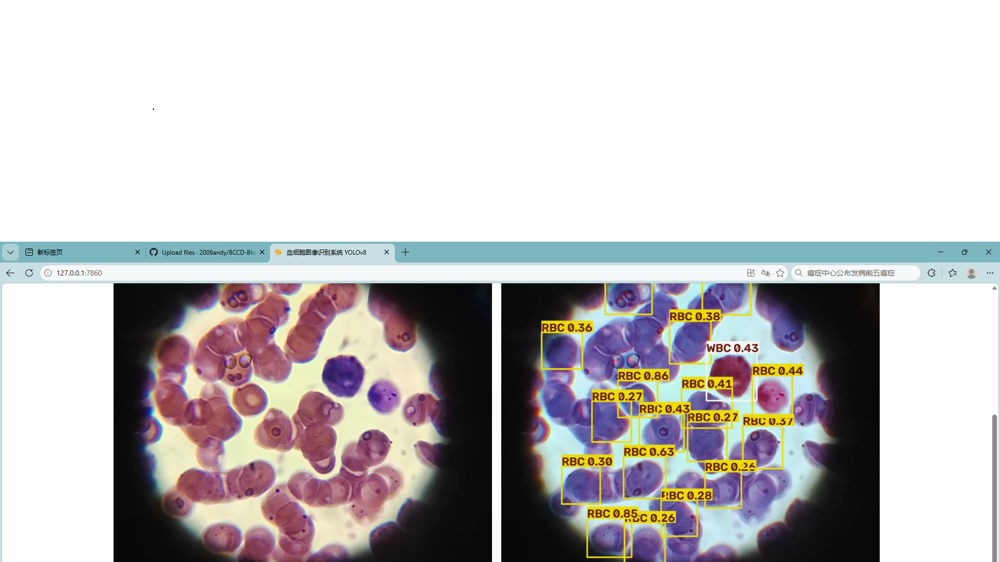

\# 血细胞图像识别系统（YOLOv8 + Gradio Web）

> 医学检验方向目标检测项目，用于血涂片显微图像中白细胞、红细胞、血小板识别与自动计数


\## 📌 项目介绍

本项目基于YOLOv8目标检测算法，实现血细胞检测；使用Gradio搭建网页可视化前端，上传血涂片图片即可自动完成目标定位、分类、计数，适合医学检验辅助筛查演示。


\## ✨ 功能亮点

\- ✅ YOLOv8模型训练：使用BCCD血细胞数据集训练检测器，识别WBC白细胞、RBC红细胞、Platelets血小板

\- ✅ Web交互界面：Gradio快速部署前端，本地网页直接使用，无需复杂部署

\- ✅ 自动输出：返回带标注框的结果图 + 各类细胞统计表格

\- ✅ 一键推理：上传图片 → 自动检测 → 可视化结果


\## 🛠️ 环境依赖

```bash

pip install ultralytics gradio pandas

## 📷 演示截图



